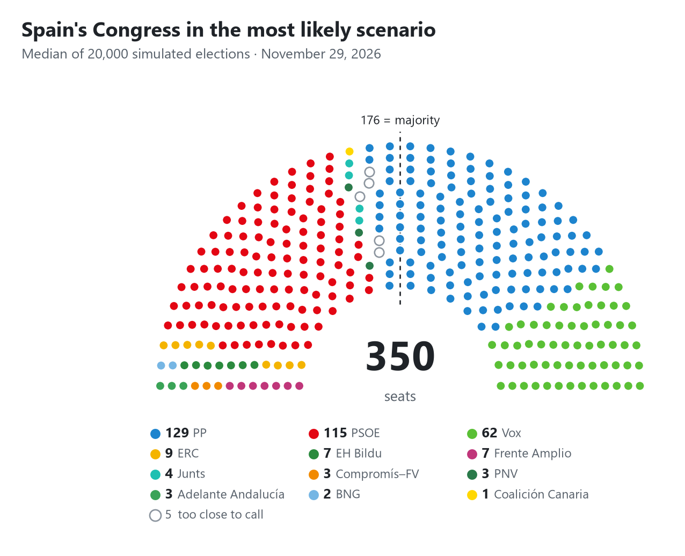
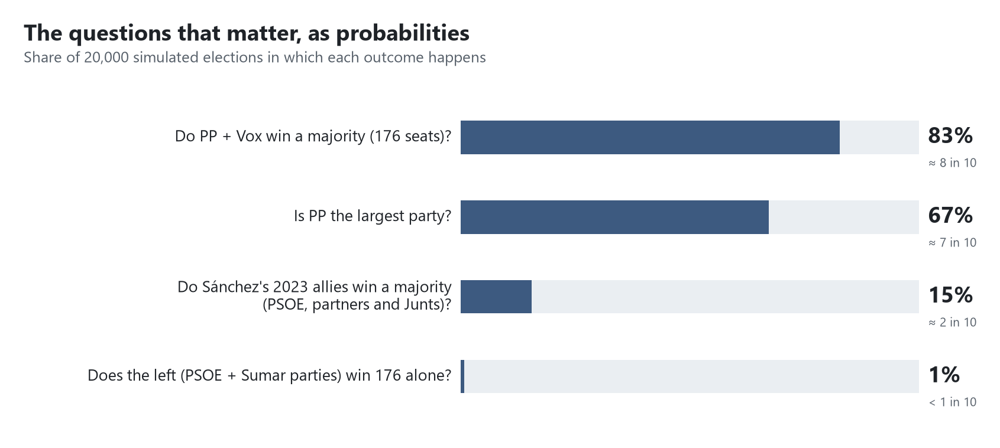
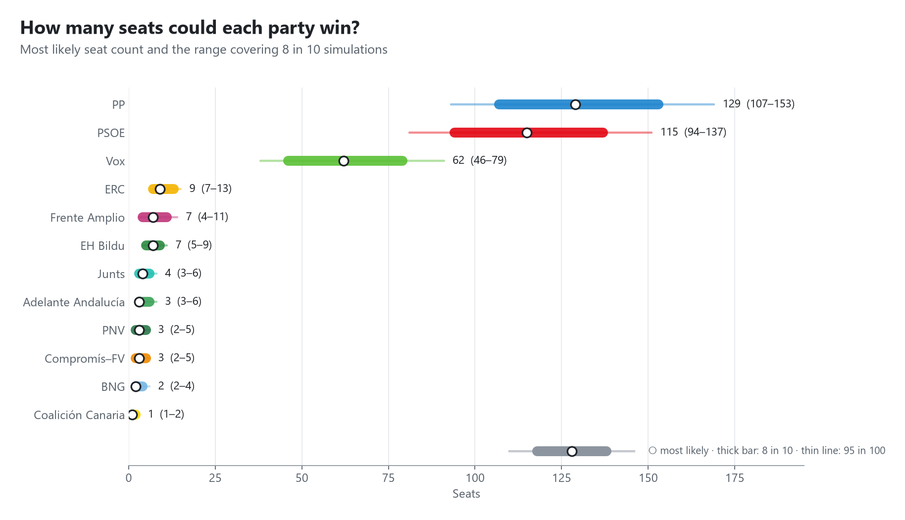
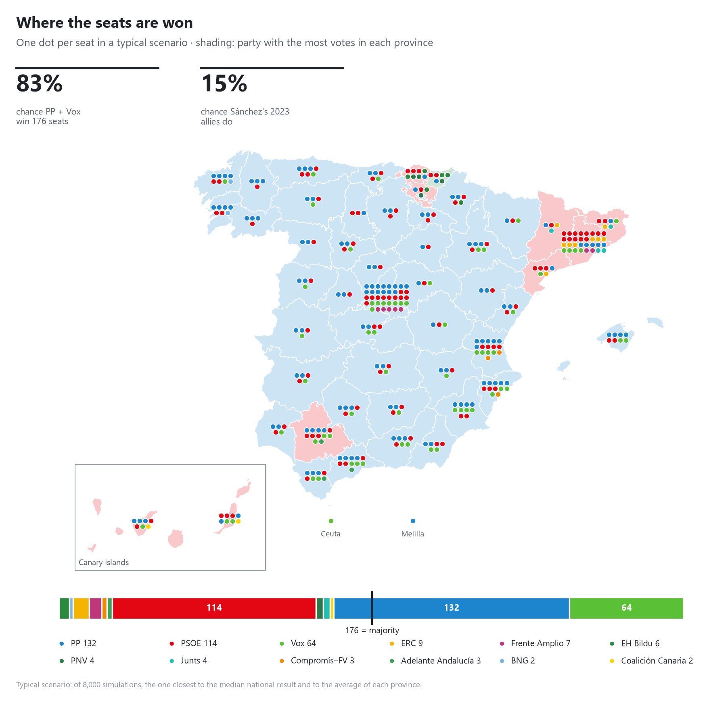
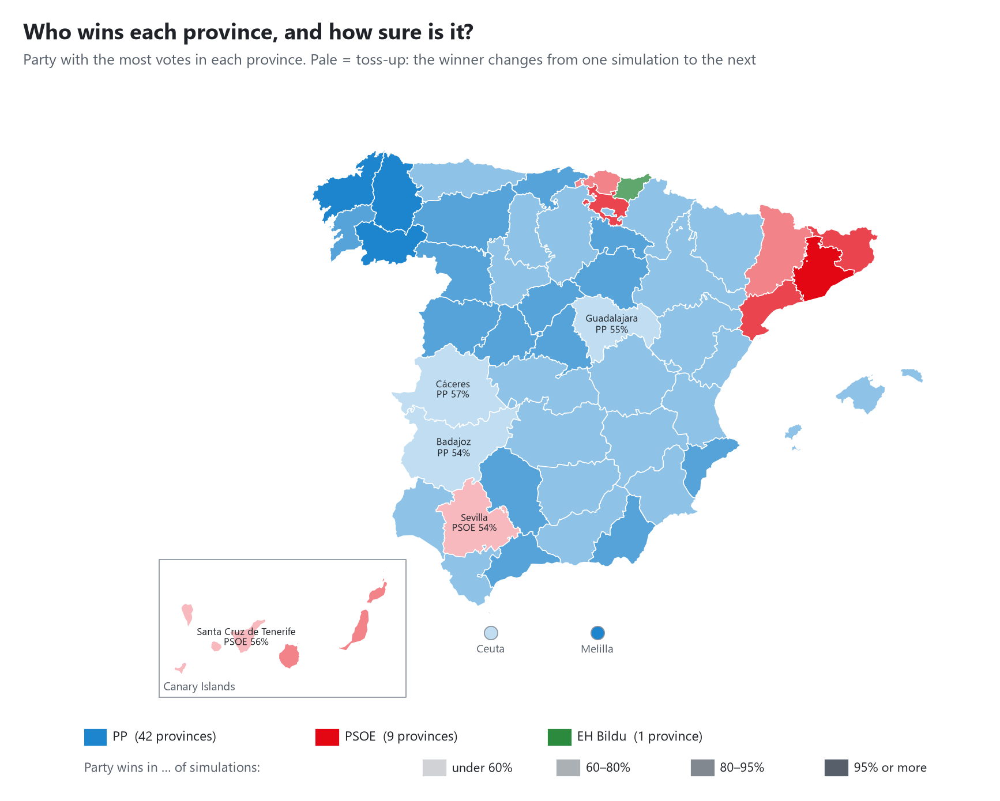
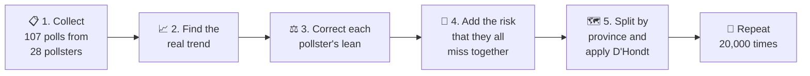
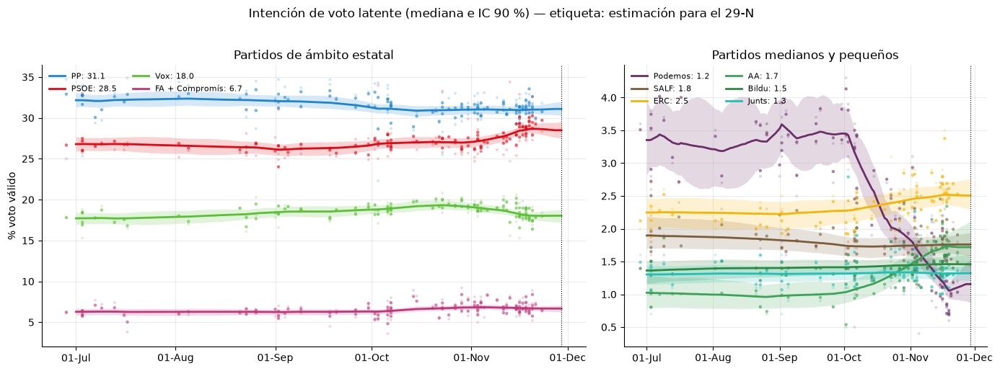
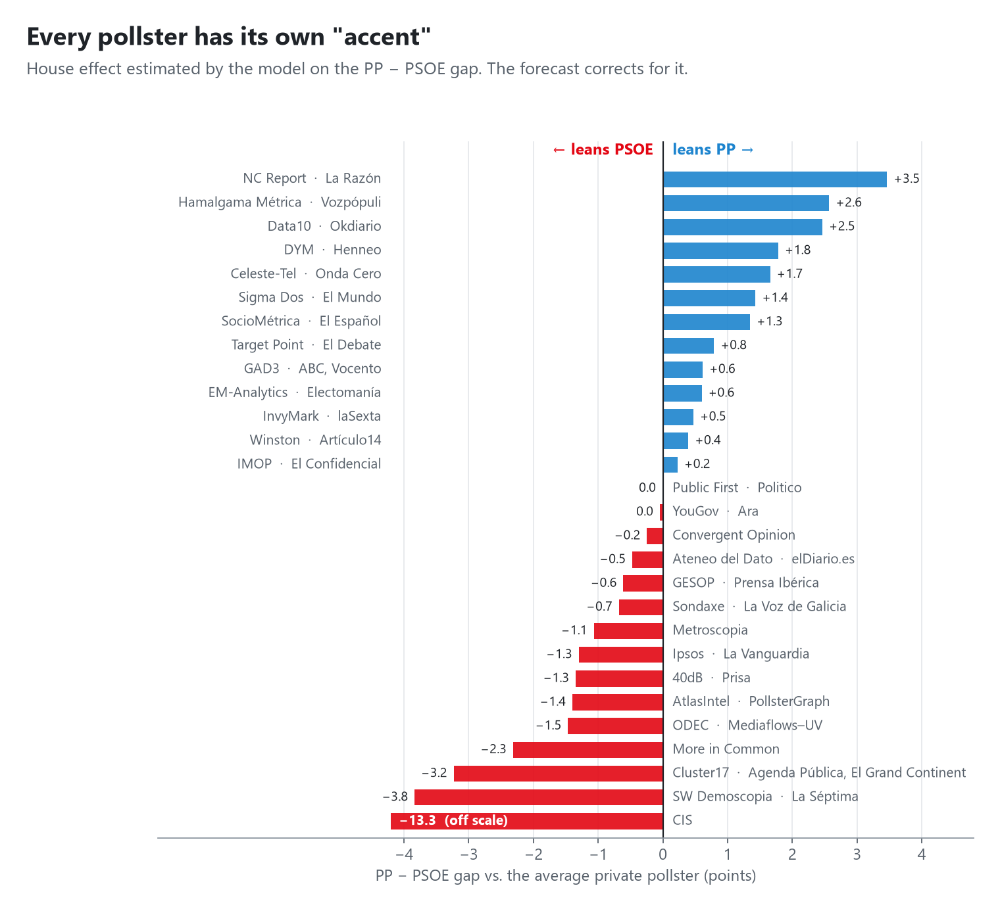
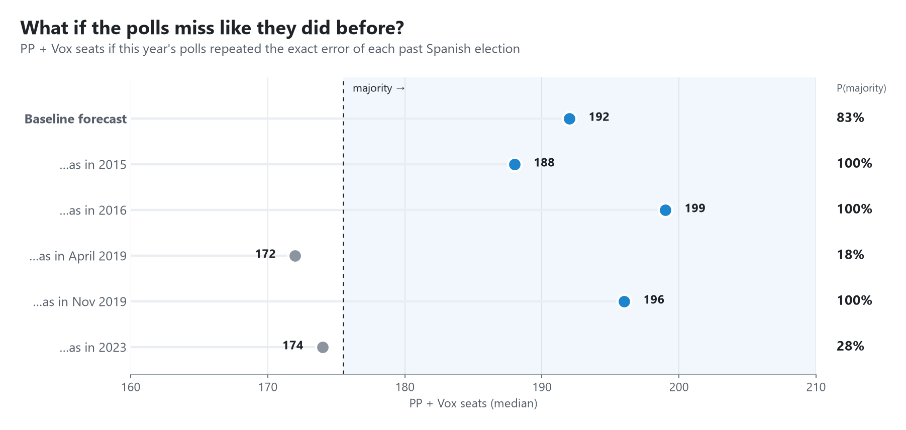
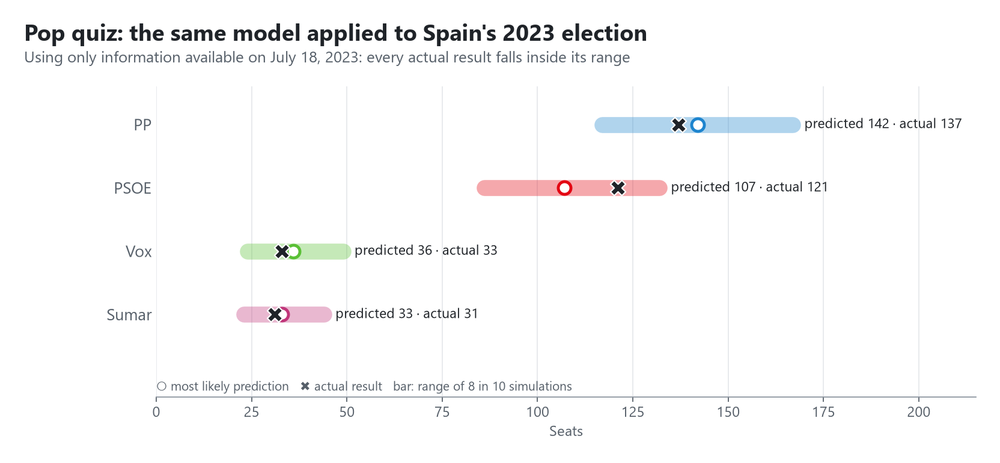

<sub>🇬🇧 English · 🇪🇸 [Español](README.md)</sub>

# 🗳️ Spain's November 29, 2026 general election: what do the polls *really* say?

[](https://colab.research.google.com/github/Sergiibut05/elecciones-29N-2026/blob/main/Elecciones_29N_modelo_bayesiano.ipynb)

A statistical model that combines **every published poll**, corrects for each pollster's lean and **simulates election night 20,000 times** using Spain's real electoral system (52 provinces, D'Hondt, 3 % threshold).

> **In one sentence:** PP would be the most-voted party, and PP + Vox reach a majority in **about 8 out of 10 simulations**. But if the polls miss the way they did in 2023, that chance falls to **under 3 in 10**.

<sub>Data frozen on Nov 23, 2026, the last legal day to publish polls in Spain. A statistical exercise using public data, not an official forecast.</sub>

<details>
<summary><b>New to Spanish politics? 30-second guide to the parties</b></summary>

<br>

| Party | Where it stands |
|---|---|
| 🔵 **PP** (Partido Popular) | Centre-right |
| 🔴 **PSOE** | Centre-left, Pedro Sánchez's party |
| 🟢 **Vox** | Hard right |
| 🟣 **Frente Amplio, Compromís, Podemos** | Left of PSOE (successors of the *Sumar* alliance) |
| **SALF** (*Se Acabó La Fiesta*) | Anti-establishment, new in 2024 |
| **ERC, Junts** | Catalan pro-independence (left and centre-right) |
| **EH Bildu, PNV** | Basque (left-wing pro-independence; centre-right nationalist) |
| **BNG, Coalición Canaria, Adelante Andalucía** | Galician, Canarian and Andalusian regional parties |

A government needs **176 of 350 seats** (or enough abstentions) to be confirmed. In 2023 Sánchez was re-elected with the support of the left plus Catalan, Basque, Galician and Canarian parties: that is the "2023 investiture bloc" below.

</details>

---

## 📊 The result in 30 seconds

<p align="center"></p>

| | Estimated vote | Most likely seats | Likely range* |
|---|:---:|:---:|:---:|
| 🔵 **PP** | 31.1 % | **129** | 107 – 153 |
| 🔴 **PSOE** | 28.5 % | **115** | 94 – 137 |
| 🟢 **Vox** | 18.0 % | **62** | 46 – 79 |
| 🟣 **Frente Amplio + Compromís** | 6.7 % | **7 + 3** | 4–11 / 2–5 |
| 🟡 **ERC** | 2.5 % | **9** | 7 – 13 |

<sub>*Range covering 8 in 10 simulations. Full tables in `resultados_29N.xlsx`.</sub>

### The questions that matter

<p align="center"></p>

> 💡 **How to read 83 %:** it does not mean "it will happen". It means that if this election could be run 10 times with the same uncertainty, PP + Vox would reach 176 seats about 8 times. The other 2 times they wouldn't. A 17 % chance is roughly rolling a six on a die: it happens all the time.

### How many seats could each party win?

<p align="center"></p>

The ranges are wide on purpose: a few tenths of a point in small provinces flip seats, and all the polls can be wrong at the same time (see below).

### 🗺️ Where the seats are won

<p align="center"></p>

Each dot is one seat in a **typical scenario**: one of the simulations, picked because its national result is among the closest to the most likely outcome and because it resembles the average of each province. It is one concrete outcome, so in the closest provinces a seat could go the other way. Ceuta, for example, goes to Vox here even though PP is slightly favoured.

<p align="center"></p>

PP is favoured to win the most votes in **42 provinces**, PSOE in **9** (all four Catalan provinces, Biscay, Álava, Seville and both Canarian provinces) and EH Bildu in Gipuzkoa. The pale provinces are **toss-ups**: Seville, Badajoz, Cáceres, Guadalajara, Santa Cruz de Tenerife and Ceuta.

---

## 🧠 How does it work? (no formulas)



### 1. Collect and clean the polls 📋

Every national poll since July 1 is downloaded automatically from Wikipedia, plus 49 regional and provincial polls. **Not all of them count:**

| Excluded… | Because… |
|---|---|
| Polls commissioned by parties | no published method and an obvious interest |
| Third-party re-weightings of the state pollster (CIS) | they reuse the same CIS interviews: they would be counted twice |
| Poll aggregators | already an average; including them would double count |
| Overlapping daily *trackers* | today's release shares interviews with yesterday's |

### 2. Find the real trend 📈

Each poll is a blurry photo. The model assumes there is a "true" voting intention that changes slowly, and finds the line that best explains **all** the photos at once. The shaded band is the uncertainty.

<p align="center"></p>

<sub>Chart labels in Spanish: left panel = national parties, right panel = mid-sized and small parties; y-axis = % of valid votes.</sub>

### 3. Correct each pollster's "accent" ⚖️

Every company weights its sample differently, so some consistently give a party more than others do. The model **estimates this from the data**: nobody decides by hand who leans which way.

<p align="center"></p>

> **Note:** "lean" here does not mean bad faith. It means a consistent difference from the average private pollster. The state pollster (CIS) is off the scale (it gives PSOE a lead about 13 points larger than the private average), so the model treats it separately.

### 4. Assume they can all miss at once 🎲

Correcting individual leans centres the polls on **the industry average**, but the average itself can be wrong. This is how it missed in recent elections (points; **+** = polls **overestimated** the party):

| Election | PP | PSOE | Vox | Left of PSOE |
|---|:---:|:---:|:---:|:---:|
| 2015 | −1.3 | −1.6 | – | −3.1 |
| 2016 | −3.3 | −1.4 | – | **+3.5** |
| April 2019 | **+4.0** | +0.3 | +0.6 | −1.1 |
| November 2019 | +0.2 | −0.8 | −2.0 | −0.6 |
| 2023 | +1.2 | **−3.5** | +0.8 | +0.9 |

There is no fixed pattern, so in every simulation the model **draws a shared error** of that size (about ±3 points for a party polling 30 %).

Do the misses come in blocs, overestimating the right while underestimating the left? The model measures this from history: the correlation turns out **very low (ρ ≈ 0.04)**, so nearly all of the error is party-specific. As a final check, the model's uncertainty about the gap between the blocs (±7.5 points) is **larger** than the polls' actual historical error on that gap (±5.2 points). The model errs on the side of caution, not overconfidence.

The next chart shows what would happen if this year's polls repeated **exactly** the error of each past election:

<p align="center"></p>

> **This is the most important chart in the project.** Whether PP + Vox get a majority depends mostly on whether the polls are right. With errors like 2015, 2016 or November 2019 it would be almost certain; with errors like April 2019 or 2023, they would most likely **fall short**.

### 5. From votes to seats 🗺️

Spain does not elect 350 MPs in one national count, but in **52 provincial elections**. In each simulation:

1. The national vote is spread across provinces following the 2023 electoral map, adapted to the 2026 alliances (Frente Amplio, Compromís, SALF, Adelante Andalucía…).
2. Typical regional and provincial variation is added, adjusted with **regional and provincial polls**. For example, Frente Amplio does better in Aragon thanks to its joint ticket with CHA. To avoid over-trusting a single local poll:
   - the model measures how far local polls missed in 2023 against the actual result (about ±12 % of each party's vote, on top of sampling error) and gives them that margin;
   - if the company also runs national polls, its "accent" from step 3 is removed first.
3. The real electoral law is applied: **3 % threshold and D'Hondt** in each province, and a single seat each in Ceuta and Melilla.

✅ *Check:* applied to the actual 2023 votes, this engine reproduces the 350 official seats **exactly**.

---

## 🧪 Pop quiz: would it have got 2023 right?

The best way to know whether a model is honest is to **test it on the past**. The same code was run as if it were July 18, 2023, **using only the information available that day**: 2023 polls, the 2019 electoral map and historical errors up to 2019.

<p align="center"></p>

| What went right ✅ | What went wrong ❌ |
|---|---|
| All 12 parties landed **inside** their likely range | It underestimated PSOE (107 seats predicted against 121 actual) |
| It beat a simple poll average (mean error 0.59 vs 0.65 points) | It gave PP + Vox a 57 % chance of a majority; they got 170 |
| Given the real national vote, the provincial engine is nearly seat-perfect (PP + Vox: 171 vs 170) | |

**Lesson:** the 2023 miss came from **the polls**, which all underestimated PSOE together, not from the model. That is why the model includes the shared error from step 4. Without it, it would have given PP + Vox an 80 % chance of a majority in 2023 and left 3 of the 12 parties outside their likely range.

---

## ⚠️ Limitations (read before sharing)

- **Polls are the only source.** If they all share a new bias, the model only covers it through the historical error.
- **There are only five past elections to measure how polls miss.** The bloc correlation (ρ ≈ 0.04) and the local-poll error are estimated from very little data. In 4 of those 5 elections the polls favoured the right, but with so few cases that is indistinguishable from chance, so the model does not correct in either direction.
- **New parties** (Frente Amplio, SALF, Compromís–FV) are placed on the map with reasonable but untestable assumptions.
- **A single backtest (2023)** shows the model is coherent, not infallible.

---

## 🚀 How to run it

**Easy option:** click [](https://colab.research.google.com/github/Sergiibut05/elecciones-29N-2026/blob/main/Elecciones_29N_modelo_bayesiano.ipynb) and choose *Runtime → Run all*. It installs what it needs. It takes **about 3–5 minutes** with the [nutpie](https://github.com/pymc-devs/nutpie) sampler, which is installed and used automatically (30–35 minutes if you force PyMC's default sampler). The notebook itself is in Spanish.

**Locally:**

```bash
pip install -r requirements.txt
jupyter notebook Elecciones_29N_modelo_bayesiano.ipynb   # writes resultados_29N.xlsx
python scripts/figuras_readme.py                          # rebuilds img/ (Spanish) and img/en/ (English)
```

By default it uses the **frozen copy** of the data from Nov 24, 2026 (`MODO_DATOS = "snapshot"`), so two runs give exactly the same result even if Wikipedia changes. With `"online"` it downloads everything again.

## 📁 What's in the repository

| File | What it is |
|---|---|
| `Elecciones_29N_modelo_bayesiano.ipynb` | The full model, explained step by step (in Spanish) |
| `resultados_29N.xlsx` | All tables: vote, seats, provinces, pollster leans, 2023 backtest and calibrated assumptions |
| `simulaciones_escanos_base.csv.gz` | All 20,000 seat simulations, if you want to run your own numbers |
| `scripts/figuras_readme.py` | Builds every chart and map in both READMEs from the Excel file |
| `data/provincias_espana.geojson` | Simplified outlines of the 52 provinces, for the maps |
| `img/`, `img/en/` | README charts (Spanish and English) |

---

<details>
<summary><b>🔬 Technical details</b></summary>

<br>

- **Model:** Bayesian state-space model on the multinomial log-ratio scale (reference = "others"). Daily random walk per party; hierarchical house effects $\delta_{h,k}\sim\mathcal N(0,\tau_k)$ with a sum-to-zero constraint over the private pollsters that publish each party; the CIS gets its own scale.
- **Likelihood:** logit of each published figure, with variance = sampling error (delta method, $n_{\text{eff}} = n/1.5$ clipped to 300–3,000) + rounding to one decimal + non-sampling noise $\omega$.
- **Sampling:** NUTS via nutpie (or PyMC if nutpie is missing), 4 chains × 3,000 draws; 0 divergences, $\hat R \le 1.01$, ESS > 600 in both fits.
- **Systematic error:** Student-t (5 d.f.) with σ = historical RMS on the logit scale (0.158), calibrated on the average private pollster in the final week of 2015–2023. A fraction ρ of its variance is shared by bloc (right +1, left −1), estimated by moments from the same history (ρ = 0.04). Check: the simulated SD of the right–left gap (7.5 pts) exceeds the historical RMS of that error (5.2 pts).
- **Geography:** proportional swing with raking to the national vote; regional (σ = 0.15) and provincial (σ = 0.065) noise calibrated 2019→2023; sub-national polls update those deviations through a normal–normal model. Their non-sampling error (σ = 0.12, log scale) is calibrated by comparing 2023 sub-national polls with actual results after removing the shared national error, and pollsters that also publish national polls have their house effect removed.
- **Backtest:** 2023 is predicted with prior information only (2019 map, 2015–2019 errors, *a priori* sub-national σ, no 2023 calibration).
- **Reproducibility:** frozen data plus a separately seeded random generator for each simulation block; two full runs produce identical outputs.

</details>

## 📜 License

The code (notebook and scripts) is released under the [MIT](LICENSE) license: use, modify and share it with attribution. Third-party data keep their original licenses: the Wikipedia tables are CC BY-SA and the province outlines come from click_that_hood.

<sub>Sources: poll tables from Wikipedia, which cite the original publisher of each poll; official results from Spain's Ministry of the Interior; province outlines from the <a href="https://github.com/codeforgermany/click_that_hood">click_that_hood</a> project (Code for Germany). Independent educational project.</sub>
