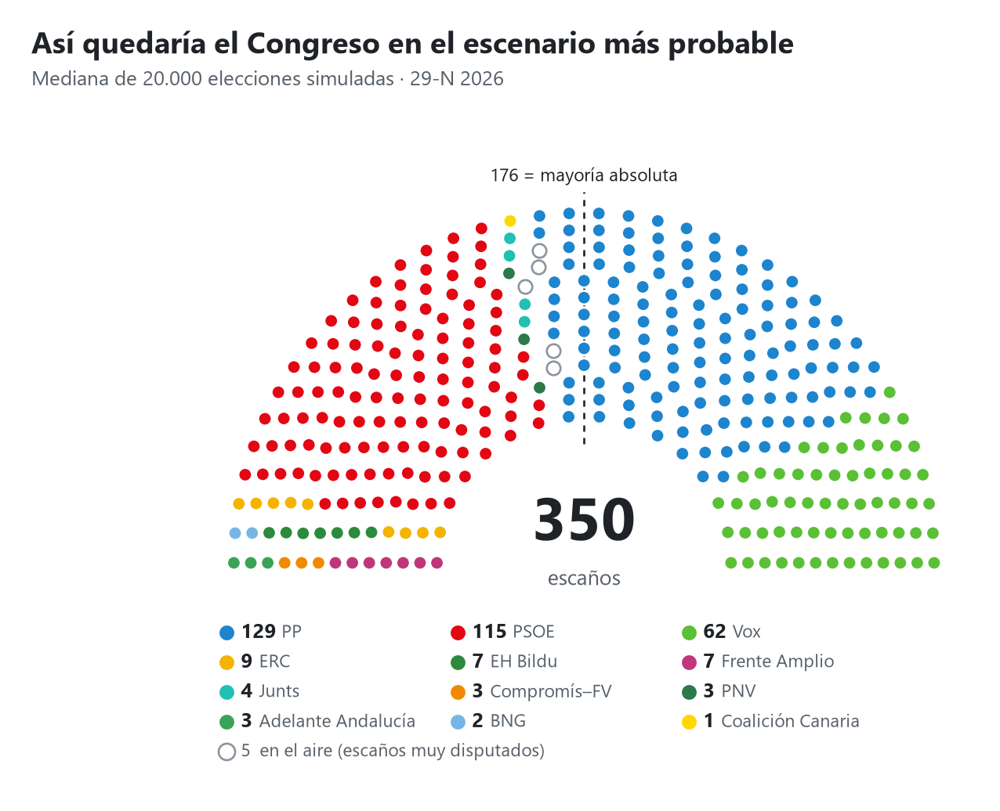
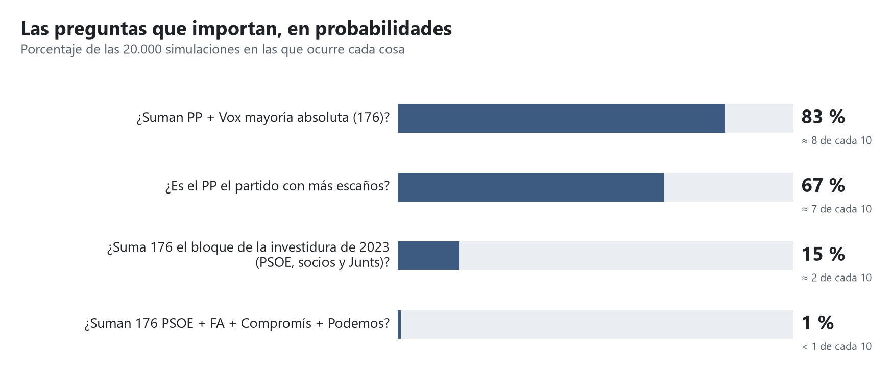
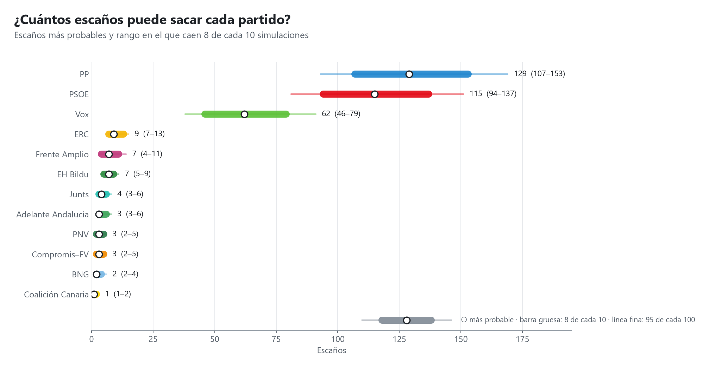
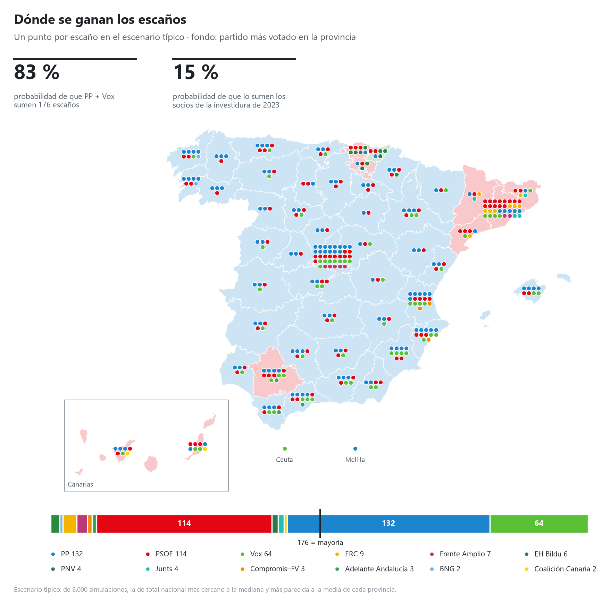
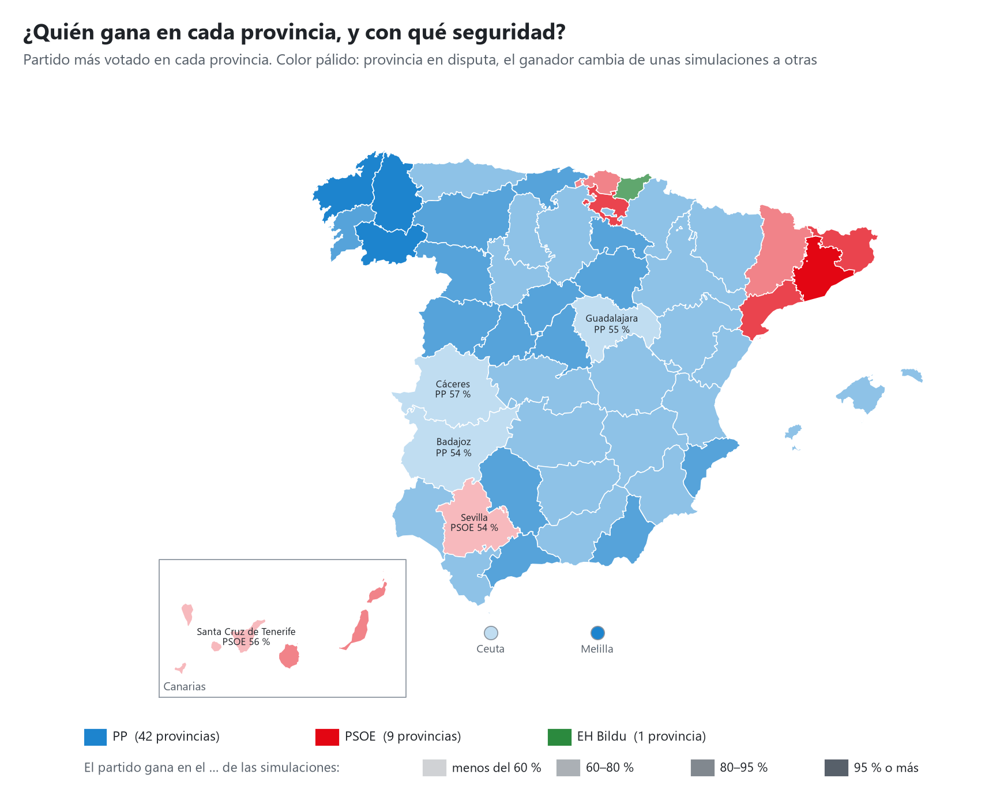
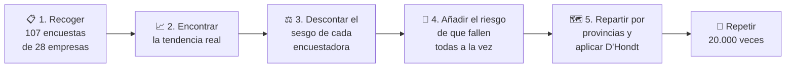
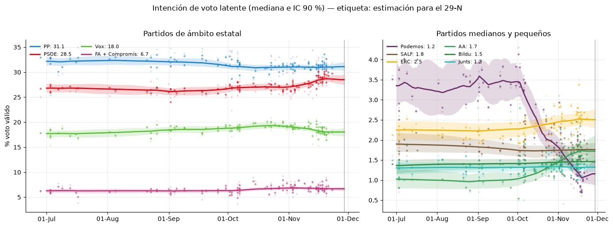
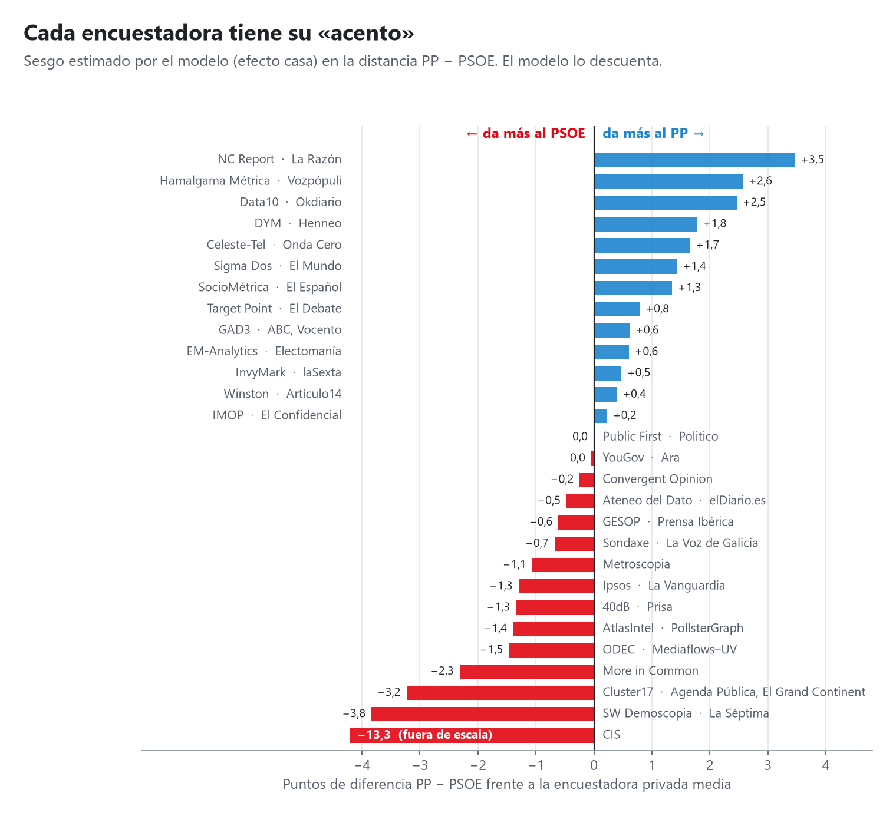
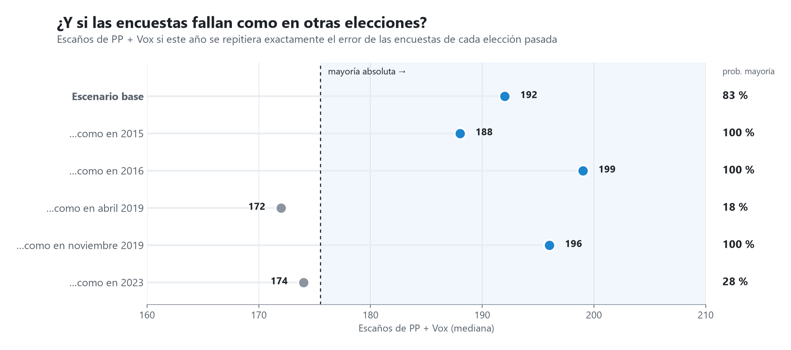
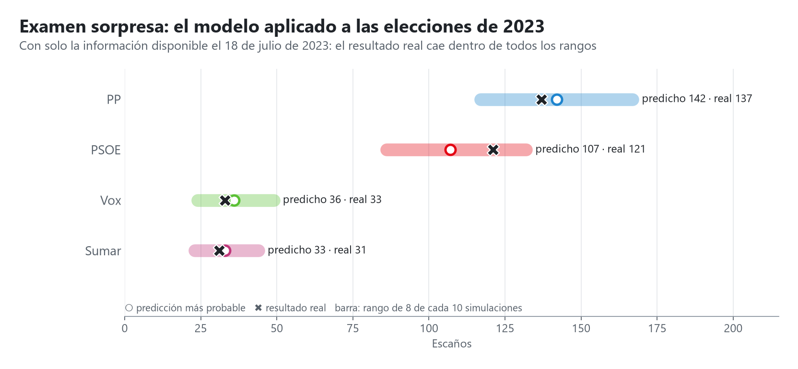

<sub>🇪🇸 Español · 🇬🇧 [English](README.en.md)</sub>

# 🗳️ Elecciones generales 29-N 2026: ¿qué dicen *de verdad* las encuestas?

Un modelo estadístico que junta **todas las encuestas publicadas**, corrige el sesgo de cada empresa y **simula 20.000 veces la noche electoral** con el sistema electoral real (52 provincias, D'Hondt y umbral del 3 %).

> **En una frase:** el PP sería la fuerza más votada y PP + Vox sumarían mayoría absoluta en **unas 8 de cada 10 simulaciones**, pero si las encuestas fallan como en 2023 esa probabilidad baja a **menos de 3 de cada 10**.

<sub>Datos cerrados el 23-nov-2026, último día legal para publicar encuestas. Ejercicio estadístico con datos públicos, no un pronóstico oficial.</sub>

---

## 📊 El resultado en 30 segundos

<p align="center"></p>

| | Voto estimado | Escaños más probables | Rango probable* |
|---|:---:|:---:|:---:|
| 🔵 **PP** | 31,1 % | **129** | 107 – 153 |
| 🔴 **PSOE** | 28,5 % | **115** | 94 – 137 |
| 🟢 **Vox** | 18,0 % | **62** | 46 – 79 |
| 🟣 **Frente Amplio + Compromís** | 6,7 % | **7 + 3** | 4–11 / 2–5 |
| 🟡 **ERC** | 2,5 % | **9** | 7 – 13 |

<sub>*Rango en el que cae el resultado en 8 de cada 10 simulaciones. La tabla completa está en `resultados_29N.xlsx`.</sub>

### Las preguntas que importan

<p align="center"></p>

> 💡 **Cómo leer un 83 %:** no significa «va a pasar». Significa que, si se pudiera repetir esta elección 10 veces con la misma incertidumbre, PP + Vox llegarían a 176 escaños unas 8 veces. Las otras 2 veces, no. Un 17 % es más o menos la probabilidad de sacar un 6 al tirar un dado: pasa a menudo.

### ¿Cuántos escaños puede sacar cada partido?

<p align="center"></p>

Los rangos son anchos a propósito: unas décimas de voto en provincias pequeñas mueven escaños, y las encuestas pueden equivocarse todas a la vez (ver más abajo).

### 🗺️ Dónde se ganan los escaños

<p align="center"></p>

Cada punto es un escaño en un **escenario típico**: una de las simulaciones, elegida porque su resultado nacional está entre los más cercanos al más probable y porque se parece a la media de cada provincia. Es un reparto concreto, así que en las provincias más disputadas el escaño podría caer del otro lado. Ceuta, por ejemplo, sale para Vox aunque el PP es ligeramente favorito.

<p align="center"></p>

El PP es el favorito para ser el más votado en **42 provincias**, el PSOE en **9** (las cuatro catalanas, Bizkaia, Álava, Sevilla y las dos canarias) y EH Bildu en Gipuzkoa. Las provincias pálidas son las que están **en el aire**: Sevilla, Badajoz, Cáceres, Guadalajara, Santa Cruz de Tenerife y Ceuta.

---

## 🧠 ¿Cómo funciona? (sin fórmulas)



### 1. Recoger y limpiar las encuestas 📋

Se descargan automáticamente de Wikipedia todas las encuestas nacionales desde el 1 de julio, además de 49 encuestas autonómicas y provinciales. **No todas valen:**

| Se descarta… | Porque… |
|---|---|
| Encuestas encargadas por partidos | no publican su método y tienen un interés evidente |
| «Cocinas» del CIS hechas por terceros | reutilizan las mismas entrevistas del CIS: se contarían dos veces |
| Agregadores (medias de encuestas) | ya son una media; meterlos sería contar doble |
| *Trackings* diarios solapados | la encuesta de hoy comparte entrevistas con la de ayer |

### 2. Encontrar la tendencia real 📈

Cada encuesta es una foto borrosa. El modelo supone que existe una intención de voto «real» que cambia poco a poco y busca la línea que mejor explica **todas** las fotos a la vez. La banda de color es el margen de incertidumbre.

<p align="center"></p>

> La caída de Podemos en octubre no es solo un cambio de opinión: desde la convocatoria se presenta dentro de ERC en Cataluña y de Compromís en la Comunitat Valenciana, así que las encuestas dejan de atribuirle ese voto.

### 3. Descontar el «acento» de cada encuestadora ⚖️

Cada empresa pondera a su manera y eso hace que algunas den sistemáticamente más a un partido. El modelo **lo estima a partir de los datos**: nadie decide a mano quién «tira» hacia un lado.

<p align="center"></p>

> **Ojo:** «sesgo» aquí no significa mala fe. Significa diferencia constante respecto a la media de las encuestadoras privadas. El CIS se sale de la escala (da al PSOE unos 13 puntos más de ventaja relativa que la media privada), por eso el modelo le da un tratamiento propio.

### 4. Asumir que todas pueden fallar a la vez 🎲

Corregir los sesgos individuales centra las encuestas en **la media del sector**, pero la media también se equivoca. Así se equivocó en las últimas elecciones (puntos; **+** = las encuestas daban **de más**):

| Elección | PP | PSOE | Vox | Izquierda del PSOE |
|---|:---:|:---:|:---:|:---:|
| 2015 | −1,3 | −1,6 | – | −3,1 |
| 2016 | −3,3 | −1,4 | – | **+3,5** |
| abril 2019 | **+4,0** | +0,3 | +0,6 | −1,1 |
| noviembre 2019 | +0,2 | −0,8 | −2,0 | −0,6 |
| 2023 | +1,2 | **−3,5** | +0,8 | +0,9 |

No hay un patrón fijo, así que en cada simulación el modelo **sortea un error común** de ese tamaño (unos ±3 puntos para un partido del 30 %).

¿Y fallan en bloque, de modo que si sobrestiman a la derecha infravaloran a la izquierda? El modelo lo mide con el historial: la correlación sale **muy baja (ρ ≈ 0,04)**, así que casi todo el error es propio de cada partido. Como comprobación final, la incertidumbre del modelo sobre la distancia entre bloques (±7,5 puntos) es **mayor** que el error real que han tenido las encuestas en esa distancia (±5,2 puntos de media). Es decir, el modelo peca de prudente, no de confiado.

La siguiente gráfica muestra qué pasaría si este año se repitiera **exactamente** el error de cada elección pasada:

<p align="center"></p>

> **Esta es la gráfica más importante del proyecto.** La mayoría de PP + Vox depende sobre todo de si las encuestas aciertan. Con errores como los de 2015, 2016 o noviembre de 2019 sería prácticamente segura; con errores como los de abril de 2019 o 2023, lo más probable es que **no** la alcanzaran.

### 5. Del voto a los escaños 🗺️

España no elige 350 diputados con un único recuento, sino en **52 elecciones provinciales**. Para cada simulación:

1. Se reparte el voto nacional por provincias según el mapa electoral de 2023, adaptado a las coaliciones de 2026 (Frente Amplio, Compromís–FV, SALF, Adelante Andalucía…).
2. Se añade la variación regional y provincial típica, corregida con las **encuestas autonómicas y provinciales**. Por ejemplo, Frente Amplio rinde más en Aragón gracias a la candidatura con CHA. Para no fiarse de más de una sola encuesta local:
   - se mide cuánto fallaron las encuestas locales en 2023 frente al resultado real (unos ±12 % del voto de cada partido, además del error de muestreo) y se les da ese margen;
   - si la empresa también hace encuestas nacionales (EM-Analytics, GESOP, DYM, Target Point…), antes se le descuenta su «acento» del paso 3.
3. Se aplica la ley electoral real: **umbral del 3 % y D'Hondt** en cada provincia, y un único escaño en Ceuta y Melilla.

✅ *Comprobación:* aplicado a los votos reales de 2023, este motor reproduce **exactamente** los 350 escaños oficiales.

---

## 🧪 Examen sorpresa: ¿habría acertado en 2023?

La mejor forma de saber si un modelo es honesto es **ponerlo a prueba con el pasado**. Se ejecutó el mismo código como si fuera el 18 de julio de 2023, **con solo la información disponible aquel día**: encuestas de 2023, mapa electoral de 2019 y errores históricos hasta 2019.

<p align="center"></p>

| Lo que salió bien ✅ | Lo que salió mal ❌ |
|---|---|
| Los 12 partidos cayeron **dentro** de su rango probable | Infravaloró al PSOE (106 escaños previstos frente a 121 reales) |
| Corrigió mejor que la media simple de encuestas (error medio de 0,59 frente a 0,65 puntos) | Daba un 57 % a la mayoría de PP + Vox, que se quedaron en 170 |
| Con el voto nacional real, el reparto por provincias acierta casi al escaño (PP + Vox: 171 frente a 170) | |

**Lección:** el fallo de 2023 vino de **las encuestas**, que infravaloraron al PSOE todas a la vez, no del modelo. Por eso el modelo incluye el error común del paso 4. Sin él, en 2023 habría dado un 80 % a la mayoría de PP + Vox y habría dejado fuera de su rango probable a 3 de los 12 partidos.

---

## ⚠️ Limitaciones (leer antes de compartir)

- **Las encuestas son la única fuente.** Si todas comparten un sesgo nuevo, el modelo solo lo cubre con el error histórico.
- **Solo hay cinco elecciones para medir cómo fallan las encuestas.** La correlación entre bloques (ρ ≈ 0,04) y el error de las encuestas locales se estiman con muy pocos datos. En 4 de esas 5 elecciones las encuestas favorecieron a la derecha, pero con tan pocos casos no se distingue del azar, así que el modelo no corrige en ninguna dirección.
- **Partidos nuevos** (Frente Amplio, SALF, Compromís–FV) se sitúan en el mapa con supuestos razonables pero que no se pueden comprobar.
- **Una sola prueba hacia atrás (2023)** demuestra coherencia, no infalibilidad.

---

## 🚀 Cómo ejecutarlo

**Opción fácil:** abre `Elecciones_29N_modelo_bayesiano.ipynb` en [Google Colab](https://colab.research.google.com/) y pulsa *Entorno de ejecución → Ejecutar todas*. Instala lo que necesita solo. Tarda **unos 3–5 minutos** con el muestreador [nutpie](https://github.com/pymc-devs/nutpie), que se instala y usa automáticamente (30–35 minutos si se fuerza el estándar de PyMC).

**En local:**

```bash
pip install -r requirements.txt
jupyter notebook Elecciones_29N_modelo_bayesiano.ipynb   # genera resultados_29N.xlsx
python scripts/figuras_readme.py                          # regenera img/ (castellano) e img/en/ (inglés)
```

Por defecto usa la **copia congelada** de los datos del 24-nov-2026 (`MODO_DATOS = "snapshot"`), así que dos ejecuciones dan exactamente el mismo resultado aunque Wikipedia cambie. Con `"online"` vuelve a descargarlo todo.

## 📁 Qué hay en el repositorio

| Archivo | Qué es |
|---|---|
| `Elecciones_29N_modelo_bayesiano.ipynb` | El modelo completo, explicado paso a paso |
| `resultados_29N.xlsx` | Todas las tablas: voto, escaños, provincias, sesgos, prueba 2023 y supuestos calibrados |
| `simulaciones_escanos_base.csv.gz` | Las 20.000 simulaciones de escaños, por si quieres hacer tus propias cuentas |
| `scripts/figuras_readme.py` | Genera las gráficas y mapas de este README a partir del Excel |
| `data/provincias_espana.geojson` | Contornos de las 52 provincias, simplificados, para los mapas |
| `img/`, `img/en/` | Gráficas del README (castellano e inglés) |
| `README.en.md` | Este README en inglés |

---

<details>
<summary><b>🔬 Para quien quiera el detalle técnico</b></summary>

<br>

- **Modelo:** espacio de estados bayesiano en escala *log-ratio* multinomial (referencia = «otros»). Paseo aleatorio diario por partido; efectos casa jerárquicos $\delta_{h,k}\sim\mathcal N(0,\tau_k)$ con restricción de suma cero sobre las encuestadoras privadas que publican cada partido; el CIS se modela aparte con una escala propia.
- **Verosimilitud:** logit de cada cifra publicada con varianza = error muestral (método delta, $n_{\text{eff}} = n/1{,}5$ recortado a 300–3.000) + redondeo a una décima + ruido no muestral $\omega$.
- **Muestreo:** NUTS con nutpie (o PyMC si no está instalado), 4 cadenas × 3.000 iteraciones; 0 divergencias, $\hat R \le 1{,}01$, ESS > 600 en ambos ajustes.
- **Error sistemático:** t de Student (5 g.l.) con σ = RMS histórico en escala logit (0,158), calibrado con la media de las encuestadoras privadas de la última semana en 2015–2023. Una fracción ρ de su varianza es común por bloque (derecha +1, izquierda −1), estimada por momentos con el mismo historial (ρ = 0,04). Comprobación: la desviación típica simulada de la brecha derecha–izquierda (7,5 pts) supera el RMS histórico de ese error (5,2 pts).
- **Territorio:** *swing* proporcional con *raking* al voto nacional; ruido regional (σ = 0,15) y provincial (σ = 0,065) calibrado 2019→2023; las encuestas subnacionales actualizan esas desviaciones con un modelo normal–normal. Su error no muestral (σ = 0,12 en escala log) se calibra comparando las encuestas subnacionales de 2023 con el resultado real, una vez descontado el error nacional común, y a las empresas con encuestas nacionales se les descuenta su efecto casa.
- **Prueba hacia atrás:** 2023 se predice solo con información anterior (mapa de 2019, errores 2015–2019, σ subnacional *a priori*, sin la calibración con 2023).
- **Reproducibilidad:** copia congelada de los datos y un generador aleatorio con semilla propia para cada bloque de simulaciones; dos ejecuciones completas dan salidas idénticas.
- **Escaños:** D'Hondt con umbral del 3 % por circunscripción, 20.000 simulaciones.

Todo está explicado y comentado en el notebook, sección por sección.

</details>

## 📜 Licencia

El código (notebook y scripts) se publica con licencia [MIT](LICENSE): puedes usarlo, modificarlo y compartirlo citando la autoría. Los datos de terceros conservan su licencia original: las tablas de Wikipedia son CC BY-SA y los contornos provinciales vienen de click_that_hood.

<sub>Fuentes: tablas de encuestas de Wikipedia, que citan la publicación original de cada encuesta; resultados del Ministerio del Interior; contornos provinciales del proyecto <a href="https://github.com/codeforgermany/click_that_hood">click_that_hood</a> (Code for Germany). Proyecto educativo e independiente.</sub>
